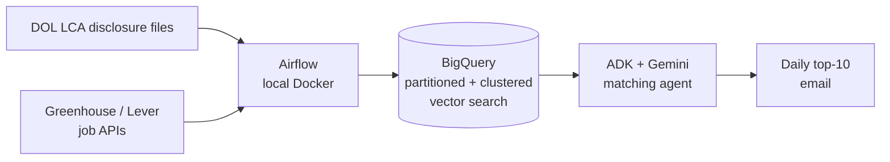

# H-1B Job Matching Agent

An end-to-end data engineering + AI agent project that finds jobs at companies that actually sponsor H-1B visas, ranks those sponsors, and emails a daily top-10 list of matching roles — with a focus on remote-friendly employers.

It combines public U.S. Department of Labor (DOL) Labor Condition Application (LCA) filings with live job postings from Greenhouse and Lever, models them in BigQuery, and uses an ADK + Gemini agent to match jobs to a candidate.

## Architecture



| Layer | Tooling |
|---|---|
| Ingestion & cleaning | Python, pandas, Parquet |
| Orchestration | Apache Airflow (local Docker) |
| Warehouse | BigQuery — partitioned by decision date, clustered by company and worksite state, vector search for job matching |
| Agent | Google ADK + Gemini |
| Delivery | Daily email digest |

## Roadmap

| Phase | Scope | Status |
|---|---|---|
| 1 | LCA data → cleaning → company profiles → sponsor ranking → BigQuery | Pipeline complete; BigQuery load in progress |
| 2 | Greenhouse / Lever job ingestion, joined to sponsors | Planned |
| 3 | Airflow DAGs for scheduled runs | Planned |
| 4 | ADK + Gemini matching agent with BigQuery vector search | Planned |
| 5 | Daily top-10 email | Planned |

## Data source

[DOL Office of Foreign Labor Certification — LCA disclosure data](https://www.dol.gov/agencies/eta/foreign-labor/performance). Every H-1B petition requires a certified LCA, so these filings show which employers sponsor, for which roles, where, and at what wage.

Current input: `LCA_Disclosure_Data_FY2026_Q3.xlsx` (437,496 filings, ~100 columns).

**Privacy:** the raw files contain names, emails and phone numbers of employer contacts, attorneys and form preparers. Those columns are dropped at ingest and never stored or committed. Raw and intermediate data are excluded from the repo via `.gitignore`.

## Phase 1 pipeline

All logic lives in `ingest/clean_lca.py` as small, testable functions. `run()` chains them into one pipeline that both the BigQuery loader and the future Airflow DAG call:

```
filter_rows → standardize_types → annualize_wages → build_company_key
→ build_company_profile → add_location_and_wage_stats → rank_sponsors
```

### 1. Column selection — `explore_lca.py`
Keeps 35 of ~100 columns (case, role, employer, company-type signals, worksite, wages). Reads everything as text so FEINs and ZIP codes keep leading zeros, and caches the slow Excel read as Parquet.

### 2. Row filtering — `filter_rows`

| Step | Rows |
|---|---|
| Raw | 437,496 |
| H-1B only (drops E-3, H-1B1 Chile/Singapore) | 426,952 |
| Certified + Certified-Withdrawn | 417,721 |
| Deduplicated on `CASE_NUMBER` | 417,721 |

### 3. Type standardization — `standardize_types`
Trims text and nulls empty strings; maps `Yes/No` and `Y/N` to nullable booleans; parses dates; casts counts and wages to numbers; normalizes FEINs (9 digits) and ZIP codes (5 digits) as text. A conversion-failure report compares null counts before and after so nothing is silently coerced — result: 0 failures.

### 4. Wage annualization — `annualize_wages`
Converts hourly, weekly, bi-weekly and monthly pay to annual (Hour × 2080, Week × 52, Bi-Weekly × 26, Month × 12) and computes `wage_to_pw_ratio` (offered wage ÷ prevailing wage).

- Fixes obvious unit errors (e.g. `151000` entered as *Hour*): any raw amount ≥ $30k is treated as annual, tracked in `wage_unit_corrected`. This cut suspect wages from 488 (0.12%) to 52 (0.01%).
- Flags the remaining out-of-range wages as `wage_is_suspect` instead of dropping them; they are excluded from wage aggregates.
- Sanity checks pass: the 1st-percentile wage/PW ratio is exactly 1.000 (no filing below prevailing wage), and median wage rises cleanly with wage level — I: $86k, II: $112k, III: $135k, IV: $167k.

### 5. Company key — `build_company_key`
- **Key = `EMPLOYER_FEIN`** — the legal entity that files the petition, and the one an H-1B transfer goes to.
- **Name normalization** handles display names and the fallback key: uppercase, `&` → `AND`, strip punctuation, leading "THE", legal suffixes (LLC, INC, CORP…), and rename / trade-name tails ("F/K/A …", "FORMERLY …", "D/B/A …").
- **Umbrella FEINs** — some public systems file many distinct employers under one tax ID (e.g. all SUNY campuses). FEINs with more than 5 distinct normalized names are split by FEIN + name so each campus is its own employer (13 FEINs split).
- Subsidiaries with separate FEINs (e.g. Amazon.com Services, Amazon Web Services) stay separate legal employers.
- Result: 57,087 raw names → 52,585 normalized → 51,901 company keys.

### 6. Company type labels — `build_company_profile`
One row per company, labeled by NAICS code plus filing behavior. Rules apply in priority order:

| Label | Rule |
|---|---|
| Staffing | NAICS `5613*` |
| IT Consulting | IT-services / consulting NAICS **and** (≥30% of filings at client sites **or** ≥50% H-1B dependent) |
| Client placement | Any NAICS, ≥50% of filings at client sites |
| Professional services | Management consulting / accounting NAICS (`5416*`, `5412*`) not meeting the placement tests |
| University (likely cap-exempt) | NAICS `6113*` — can file outside the H-1B lottery |
| Research | NAICS `5417*` |
| Direct employer | Everything else |

NAICS alone isn't enough — big tech can share IT-services codes — so client-site share (`SECONDARY_ENTITY`) and H-1B dependency confirm the consulting model.

| Type | Companies | Filings |
|---|---|---|
| Direct employer | 39,248 | 259,286 |
| IT Consulting | 5,622 | 90,409 |
| University (likely cap-exempt) | 1,065 | 23,839 |
| Professional services | 2,614 | 20,739 |
| Research | 1,821 | 10,322 |
| Client placement | 1,186 | 8,508 |
| Staffing | 345 | 4,618 |

### 7. Sponsor ranking and remote signal — `add_location_and_wage_stats`, `rank_sponsors`

Sponsor quality and remote-friendliness are **kept separate on purpose**. An early version blended geographic spread into the sponsor score, which pushed small staffing firms above Google and Microsoft. Now:

**`sponsor_score` (0–100)** answers *"does this company sponsor a lot and pay well?"*

| Component | Measure | Weight |
|---|---|---|
| Volume | `log(1 + filings)` scaled to the largest sponsor | 60% |
| Pay quality | percentile of median offered wage ÷ prevailing wage | 40% |

The log scale matters: filing counts are heavy-tailed, and a plain percentile put a 54-filing firm almost level with Amazon's 13,711. Companies need ≥ 5 filings and no willful-violator flag to be ranked (10,546 of 51,901).

**Remote signal** is its own set of columns that the agent filters on:
- `n_worksite_states` and `pct_outside_top_state` — spread, not just raw state count, so a large single-HQ company with satellite offices isn't mistaken for a distributed one.
- `location_pattern` — **Distributed** (≥ 5 states and ≥ 60% of filings outside the top state), **Distributed (client sites)** for consulting / placement / staffing firms, or **Concentrated**.
- `distribution_score` — percentile of `pct_outside_top_state`.

A remote-friendly query filters on `location_pattern` and `company_type`, then sorts by `sponsor_rank`. Company type is also a filter, never part of the score — users can choose to include or exclude consulting and staffing.

**Top 10 sponsors (FY2026 Q3):**

| Rank | Company | Type | Filings | Wage ÷ PW | Score |
|---|---|---|---|---|---|
| 1 | Ernst & Young U.S. LLP | Professional services | 5,275 | 1.33 | 90.2 |
| 2 | Amazon.com Services LLC | Direct employer | 13,711 | 1.15 | 89.9 |
| 3 | Meta Platforms, Inc | Direct employer | 5,152 | 1.22 | 87.6 |
| 4 | Wal-Mart Associates, Inc. | Direct employer | 2,246 | 1.29 | 84.1 |
| 5 | Tesla, Inc. | Direct employer | 2,809 | 1.21 | 83.2 |
| 6 | Microsoft Corporation | Direct employer | 5,107 | 1.14 | 82.9 |
| 7 | Google LLC | Direct employer | 7,339 | 1.10 | 82.3 |
| 8 | Mphasis Corporation | IT Consulting | 1,145 | 1.35 | 81.0 |
| 8 | Amazon Web Services, Inc. | Direct employer | 2,440 | 1.18 | 81.0 |
| 10 | Salesforce, Inc. | Direct employer | 1,569 | 1.24 | 80.5 |

Validation: remote-first companies such as Coinbase, Reddit and HubSpot surface in the distributed direct-employer list.

### 8. Load to BigQuery — `ingest/load_bq.py`

| Table | Grain | Partitioning | Clustering |
|---|---|---|---|
| `h1b_jobs.lca_filings` | one row per case (417,721) | `decision_date`, monthly | `company_key`, `worksite_state`, `soc_code` |
| `h1b_jobs.sponsors` | one row per company (51,901) | none (small table) | `company_type`, `location_pattern` |

- Monthly partitions stay well-sized as more quarters are added; clustering matches how the agent filters (company, state, occupation).
- `sponsors` holds every company; score columns are null for unranked ones so the agent can still look up a small sponsor.
- Columns are snake_case, and every row carries a `load_ts` audit timestamp.
- `WRITE_TRUNCATE` makes reruns idempotent. Multi-quarter loads will move to a `MERGE` on `case_number` in the Airflow phase.
- Verification queries live in `sql/checks.sql` (partition counts, the remote-sponsor query).

## Known limitations
- LCA worksite fields show only the first worksite per filing; distribution is measured across many filings.
- LCAs show where people work, not whether a role is remote. "Distributed" means many locations: it captures remote-first companies (Coinbase, Reddit) but also firms with many regional or project offices (engineering, insurance). Job postings (Phase 2) separate the two.
- Large companies appear as several legal entities (e.g. four Amazon FEINs in the top 20). A parent-company rollup is a planned enhancement.
- University systems with exactly 5 campus names under one FEIN (e.g. Minnesota State) fall at the umbrella threshold and are not split.
- Annualizing hourly pay at 2,080 hours overstates part-time pay (~2% of filings).
- Cap-exempt status is inferred from NAICS; nonprofit research organizations can't be separated from for-profit R&D.
- One quarter of data has no time spread; recency weighting arrives once multiple quarters are loaded.

## Setup

```bash
git clone https://github.com/nandaReddy1212/visa_sponsership_job_agent.git
cd visa_sponsership_job_agent
python -m venv .venv
# Windows:  .venv\Scripts\activate
# macOS/Linux: source .venv/bin/activate
pip install -r requirements.txt
```

Download an LCA disclosure file from the DOL link above into `data/raw/`, update the file name in `ingest/explore_lca.py`, then run from the repo root:

```bash
python -m ingest.explore_lca   # profile columns, build the Parquet cache
python -m ingest.clean_lca     # run the pipeline and print data-quality checks
```

To load into BigQuery, authenticate and set your project (the `h1b_jobs` dataset must exist):

```bash
gcloud auth application-default login
export GCP_PROJECT=your-project-id          # PowerShell: $env:GCP_PROJECT = "your-project-id"
python -m ingest.load_bq
```

## Project structure

```
├── data/              # raw LCA files + Parquet cache (gitignored)
├── ingest/
│   ├── explore_lca.py # column selection and profiling
│   ├── clean_lca.py   # filtering, types, wages, company key, labels, ranking, run()
│   └── load_bq.py     # load filings and sponsors tables into BigQuery
├── sql/
│   └── checks.sql     # verification queries
├── requirements.txt
├── dags/              # Airflow DAGs
└── README.md
```