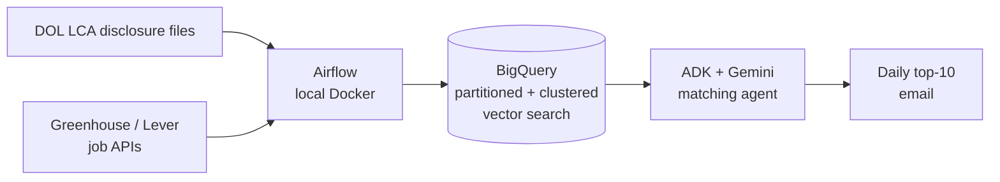

# H-1B Job Matching Agent

An end-to-end data engineering + AI agent project that finds jobs at companies that actually sponsor H-1B visas, ranks those sponsors, and emails a daily top-10 list of matching roles — with a focus on remote-friendly employers.

It combines public U.S. Department of Labor (DOL) Labor Condition Application (LCA) filings with live job postings from Greenhouse and Lever, models them in BigQuery, and uses an ADK + Gemini agent to match jobs to a candidate.

## Architecture



| Layer | Tooling |
|---|---|
| Ingestion & cleaning | Python, pandas, Parquet |
| Orchestration | Apache Airflow (local Docker) |
| Warehouse | BigQuery — partitioned by decision date, clustered by company and worksite state, vector search for job matching |
| Agent | Google ADK + Gemini |
| Delivery | Daily email digest |

## Roadmap

| Phase | Scope | Status |
|---|---|---|
| 1 | LCA data → cleaning → company profiles → sponsor ranking → BigQuery | In progress |
| 2 | Greenhouse / Lever job ingestion, joined to sponsors | Planned |
| 3 | Airflow DAGs for scheduled runs | Planned |
| 4 | ADK + Gemini matching agent with BigQuery vector search | Planned |
| 5 | Daily top-10 email | Planned |

## Data source

[DOL Office of Foreign Labor Certification — LCA disclosure data](https://www.dol.gov/agencies/eta/foreign-labor/performance). Every H-1B petition requires a certified LCA, so these filings show which employers sponsor, for which roles, where, and at what wage.

Current input: `LCA_Disclosure_Data_FY2026_Q3.xlsx` (437,496 filings, ~100 columns).

**Privacy:** the raw files contain names, emails and phone numbers of employer contacts, attorneys and form preparers. Those columns are dropped at ingest and never stored or committed. Raw and intermediate data are excluded from the repo via `.gitignore`.

## Phase 1 pipeline

All logic lives in `ingest/clean_lca.py` as small, testable functions that the Airflow DAG will call.

### 1. Column selection — `explore_lca.py`
Keeps 35 of ~100 columns (case, role, employer, company-type signals, worksite, wages). Reads everything as text so FEINs and ZIP codes keep leading zeros, and caches the slow Excel read as Parquet.

### 2. Row filtering — `filter_rows`

| Step | Rows |
|---|---|
| Raw | 437,496 |
| H-1B only (drops E-3, H-1B1 Chile/Singapore) | 426,952 |
| Certified + Certified-Withdrawn | 417,721 |
| Deduplicated on `CASE_NUMBER` | 417,721 |

### 3. Type standardization — `standardize_types`
Trims text and nulls empty strings; maps `Yes/No` and `Y/N` to nullable booleans; parses dates; casts counts and wages to numbers; normalizes FEINs (9 digits) and ZIP codes (5 digits) as text. A conversion-failure report compares null counts before and after so nothing is silently coerced — result: 0 failures.

### 4. Wage annualization — `annualize_wages`
Converts hourly, weekly, bi-weekly and monthly pay to annual (Hour × 2080, Week × 52, Bi-Weekly × 26, Month × 12) and computes `wage_to_pw_ratio` (offered wage ÷ prevailing wage).

- Fixes obvious unit errors (e.g. `151000` entered as *Hour*): any raw amount ≥ $30k is treated as annual, tracked in `wage_unit_corrected`.
- Flags remaining out-of-range wages as `wage_is_suspect` (initially 0.12%) instead of dropping them.
- Sanity checks pass: the 1st-percentile wage/PW ratio is exactly 1.000 (no filing below prevailing wage), and median wage rises cleanly with wage level — I: $86k, II: $112k, III: $135k, IV: $167k.

### 5. Company key — `build_company_key`
- **Key = `EMPLOYER_FEIN`** — the legal entity that files the petition, and the one an H-1B transfer goes to. Name normalization (uppercase, strip punctuation and legal suffixes) handles display and fallback.
- **Umbrella FEINs** — some public systems file many distinct employers under one tax ID (e.g. all SUNY campuses). FEINs with more than 5 distinct normalized names are split by FEIN + name so each campus is its own employer.
- Subsidiaries with separate FEINs (e.g. Amazon.com Services, Amazon Web Services) stay separate legal employers.
- Result: 57,087 raw names → 52,744 normalized → ~51.8k company keys.

### 6. Company type labels — `build_company_profile`
One row per company, labeled by NAICS code plus filing behavior. Rules apply in priority order:

| Label | Rule |
|---|---|
| Staffing | NAICS `5613*` |
| IT Consulting | IT-services / consulting NAICS **and** (≥30% of filings at client sites **or** ≥50% H-1B dependent) |
| Client placement | Any NAICS, ≥50% of filings at client sites |
| Professional services | Management consulting / accounting NAICS (`5416*`, `5412*`) not meeting the placement tests |
| University (likely cap-exempt) | NAICS `6113*` — can file outside the H-1B lottery |
| Research | NAICS `5417*` |
| Direct employer | Everything else |

NAICS alone isn't enough — big tech can share IT-services codes — so client-site share (`SECONDARY_ENTITY`) and H-1B dependency confirm the consulting model.

### 7. Remote signal & sponsor ranking — `add_location_and_wage_stats`, `rank_sponsors`
- **Remote signal:** distinct worksite states *and* share of filings outside the company's top state, so large single-HQ companies aren't mistaken for distributed ones. Distribution at consulting/staffing firms is labeled *client sites*, not remote.
- **Sponsor score (0–100):** percentile-ranked volume (40%), pay above prevailing wage (30%) and geographic distribution (30%). Companies need ≥5 filings and no willful-violator flag to be ranked.

## Known limitations
- LCA worksite fields show only the first worksite per filing; distribution is measured across many filings.
- LCAs show where people work, not whether a role is remote — job postings (Phase 2) provide that.
- Annualizing hourly pay at 2,080 hours overstates part-time pay (~2% of filings).
- Cap-exempt status is inferred from NAICS; nonprofit research organizations can't be separated from for-profit R&D.
- One quarter of data has no time spread; recency weighting arrives once multiple quarters are loaded.

## Setup

```bash
git clone https://github.com/nandaReddy1212/visa_sponsership_job_agent.git
cd visa_sponsership_job_agent
python -m venv .venv
# Windows:  .venv\Scripts\activate
# macOS/Linux: source .venv/bin/activate
pip install -r requirements.txt
```

Download an LCA disclosure file from the DOL link above into `data/raw/`, update the file name in `ingest/explore_lca.py`, then run from the repo root:

```bash
python -m ingest.explore_lca   # profile columns, build the Parquet cache
python -m ingest.clean_lca     # filter, clean, build company profiles and ranking
```

## Project structure

```
├── data/              # raw LCA files + Parquet cache (gitignored)
├── ingest/
│   ├── explore_lca.py # column selection and profiling
│   └── clean_lca.py   # filtering, types, wages, company key, labels, ranking
├── sql/               # BigQuery DDL and queries
├── dags/              # Airflow DAGs
└── README.md
```